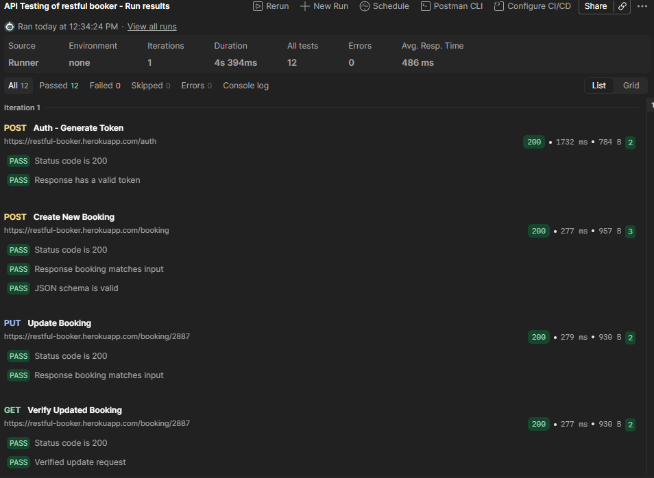
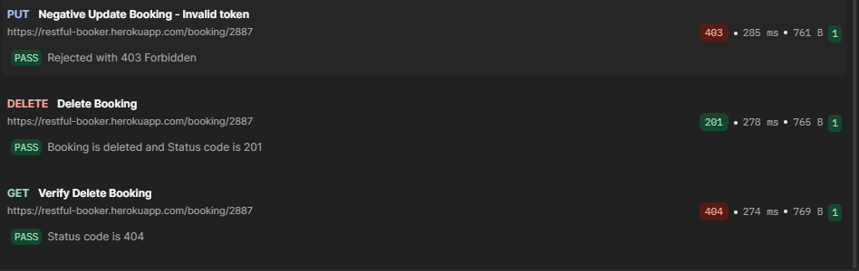

# Restful-Booker API Test Suite

Automated API tests for [Restful-Booker](https://restful-booker.herokuapp.com), built with **Postman Collection**.

## Test Flow

| # | Request | Purpose |
|---|---------|---------|
| 1 | `POST /auth` | Log in and save the auth **token** |
| 2 | `POST /booking` | Create a booking and save the **bookingid** |
| 3 | `PUT /booking/:id` | Update the booking using the saved ID and token |
| 4 | `GET /booking/:id` | Verify the update was saved |
| 5 | `PUT /booking/:id` (invalid token) | **Negative test**: expect `403 Forbidden` |
| 6 | `DELETE /booking/:id` | Delete test data |
| 7 | `GET /booking/:id` | Confirm the booking is gone (`404`) |

## What Is Tested

- **Dynamic variable chaining:** `token` and `bookingId` are extracted from responses and reused in later requests with `{{token}}` and `{{bookingId}}`.
- **Status codes:** `200` for auth, create, update and get; `201` for delete; `403` for unauthorized update; `404` after delete.
- **JSON schema validation:** the create-booking response is checked for the correct structure and data types.
- **Negative testing:** an update with an invalid token must be rejected.

## How to Run

1. Install [Postman](https://www.postman.com/downloads/) (free).
2. Download the collection file from this repo (`.json`).
3. In Postman, click **Import** and select the file.
4. Right-click the collection, choose **Run collection**, then click **Run**.

The requests must run in order, since later requests depend on values saved by earlier ones.

## Test Results

## Notes

- Login credentials (`admin` / `password123`) are the public demo credentials provided by Restful-Booker.
- Restful-Booker returns `201` instead of `204` for a successful delete.
